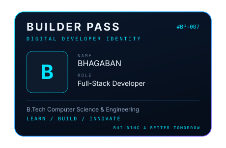

<!-- Copy this file's contents into the README.md of the repository named bablu-bd7/bablu-bd7.
     Also copy assets/builder-pass.svg into that repo at the same path. -->

 

# BHAGABAN

**CODE / BUILD / INNOVATE**

B.Tech CSE Student | Full-Stack Developer & AI Enthusiast

**IDEAS. BUILT DIFFERENT.** 
*Tools change. Curiosity doesn't.*

---

## Builder Pass

| | |
|---|---|
| **Name** | Bhagaban |
| **Role** | Full-Stack Developer |
| **Education** | B.Tech Computer Science & Engineering |
| **Focus** | Web Development · Software Engineering · AI Exploration |
| **Status** | LEARN / BUILD / INNOVATE |

*BUILDING A BETTER TOMORROW*

> The Builder Pass above is an SVG image. If your viewer doesn't animate it, it still shows as a static card. The full floating, tilting version lives in the React portfolio.

---

## Tech stack

**Frontend**

**Backend and programming**

**Tools and environments**

---

## GitHub stats

These cards load live data from third-party services. If one doesn't render, the service is temporarily unavailable.

---

## Recent activity

New activity will appear here as projects evolve.

---

## Let's connect

**OPEN TO IDEAS. READY TO BUILD.** 
Have an interesting idea? Let's make it real.

